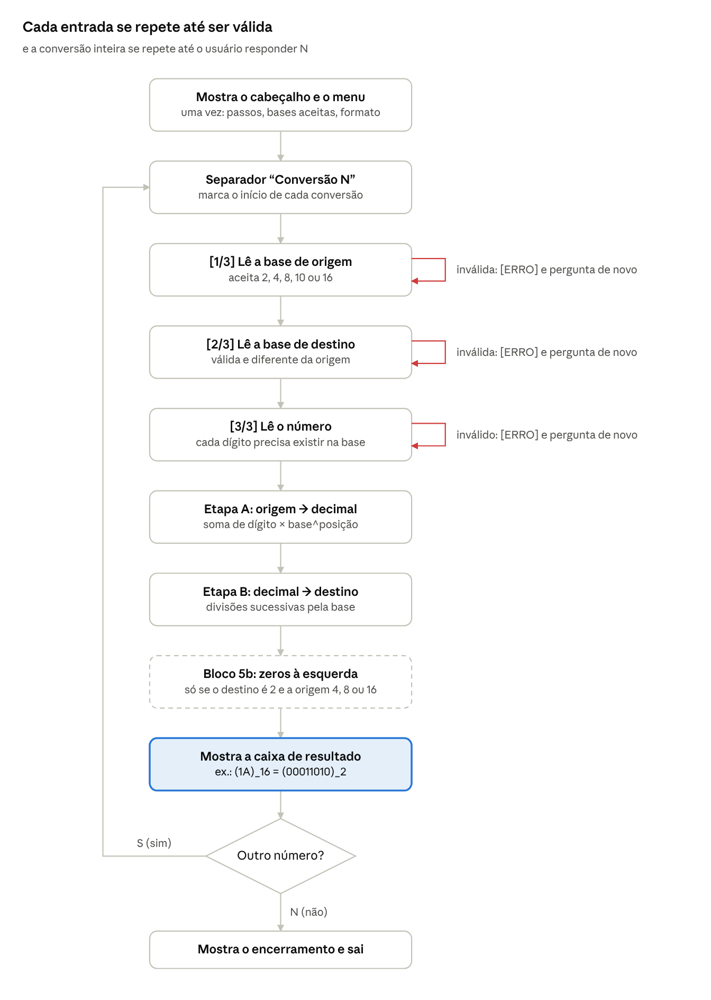

# Conversor de bases numéricas

**Autor:** Eduardo Fiori
**Disciplina:** Arquitetura e Organização de Computadores
**Instituição:** Fatec - Ribeirão Preto

Programa em Python que converte números inteiros entre as bases 2 (binário), 4 (quaternário), 8 (octal), 10 (decimal) e 16 (hexadecimal), em qualquer direção. O cálculo segue o método manual de conversão: soma de potências para chegar à base 10 e divisões sucessivas para sair dela.

| Arquivo | Conteúdo |
| --- | --- |
| [`conversor_bases.py`](conversor_bases.py) | Código do programa |
| [`docs/documentacao_tecnica.pdf`](docs/documentacao_tecnica.pdf) | Esta documentação em PDF |
| [`docs/fluxograma.png`](docs/fluxograma.png) | Fluxograma de execução |

## 1. Visão geral

O programa pede a base de origem, a base de destino e o número, valida cada entrada e mostra o resultado no formato `(1A)_16 = (00011010)_2`, equivalente à notação matemática (1A)₁₆ = (00011010)₂.

A conversão não usa as funções prontas do Python (`int(texto, base)`, `bin()`, `hex()`). Cada passo do cálculo está escrito no código.

| Item | Detalhe |
| --- | --- |
| Linguagem | Python 3.12 ou superior |
| Bibliotecas | Nenhuma (sem `import`) |
| Entrada | Teclado, pelo terminal (`input()`) |
| Saída | Terminal, somente caracteres ASCII e letras acentuadas |
| Bases aceitas | 2, 4, 8, 10 e 16 |
| Números aceitos | Inteiros positivos e zero |

## 2. Execução

1. Abra a pasta do projeto no VS Code (**Arquivo → Abrir Pasta**).
2. Abra o terminal integrado (`Ctrl + '` ou **Terminal → Novo Terminal**).
3. Execute:

```bash
python conversor_bases.py
```

A saída usa apenas caracteres ASCII (`+ - = | > _`) para bordas e símbolos, e é exibida da mesma forma no terminal do VS Code, no Windows Terminal e no `cmd`. Se as letras acentuadas aparecerem trocadas, o arquivo deve ser salvo com a codificação UTF-8 (indicada no canto inferior direito do VS Code).

## 3. Uso

### 3.1 Sequência

1. O programa mostra o cabeçalho e um menu com os passos, as bases aceitas com seus dígitos e o formato do resultado.
2. Para cada conversão, faz três perguntas: base do número (`[1/3]`), base de destino (`[2/3]`) e número (`[3/3]`).
3. Mostra o resultado numa caixa.
4. Pergunta se o usuário quer converter outro número. `S` inicia uma nova conversão; `N` encerra o programa.

Letras minúsculas são aceitas (`1a` é lido como `1A`) e espaços no início e no fim da entrada são ignorados.

### 3.2 Exemplo de execução

```text
+==============================================+
|         CONVERSOR DE BASES NUMÉRICAS         |
|            bases 2, 4, 8, 10 e 16            |
+==============================================+

COMO FUNCIONA
  1. Escolha a base do número que vai digitar
  2. Escolha a base para onde quer converter
  3. Digite o número (letras A-F só na base 16)

BASES ACEITAS
  Base  Nome          Dígitos
  2     binário       01
  4     quaternário   0123
  8     octal         01234567
  10    decimal       0123456789
  16    hexadecimal   0123456789ABCDEF

COMO O RESULTADO APARECE
  (número)_origem  =  (resultado)_destino
  Exemplo: (26)_10  =  (11010)_2
  Entre 2, 4, 8 e 16 aparece também o valor em
  decimal usado na conta. Exemplo: via (26)_10
  De 4, 8 ou 16 para 2, o binário mantém os
  zeros do agrupamento: (1A)_16 = (00011010)_2

  Entrada inválida mostra [ERRO] e pergunta de novo.

-- Conversão 1 ---------------------------------

[1/3] Base do número (2, 4, 8, 10 ou 16)
  > 16

[2/3] Base de destino (2, 4, 8, 10 ou 16)
  > 2

[3/3] Número na base 16 (dígitos aceitos: 0123456789ABCDEF)
  > 1g
  [ERRO] 'G' não existe na base 16.

  > 1a

+----------------------------------------------+
|                  RESULTADO                   |
|           (1A)_16  =  (00011010)_2           |
|                 via (26)_10                  |
+----------------------------------------------+

Converter outro número? (S/N)
  > n

================================================
       Programa encerrado. Até a próxima!
================================================
```

### 3.3 Formato do resultado

| Elemento | Exemplo | Significado |
| --- | --- | --- |
| `(número)_base` | `(1A)_16` | Número seguido da base, equivalente a (1A)₁₆ |
| Linha `via` | `via (26)_10` | Valor decimal intermediário. Aparece quando nenhuma das bases é 10 |
| Zeros à esquerda no binário | `(00011010)_2` | Quando o destino é 2 e a origem é 4, 8 ou 16, o resultado tem 2, 3 ou 4 bits por dígito de entrada (seção 4.5.3) |
| Zeros à esquerda na entrada | `(0011)_2` | O número digitado é exibido como foi informado; os zeros não alteram o valor |

### 3.4 Mensagens de erro

Toda entrada inválida mostra uma mensagem iniciada por `[ERRO]`, seguida de uma linha em branco, e a mesma pergunta é repetida. O programa não encerra por erro de digitação.

| Pergunta | Entrada inválida | Mensagem |
| --- | --- | --- |
| Base de origem ou de destino | Valor fora da lista, como `5`, `0`, `02` ou `2.0` | `[ERRO] Base inválida. Escolha 2, 4, 8, 10 ou 16.` |
| Base de destino | Igual à base de origem | `[ERRO] A base de destino é igual à de origem. Escolha outra.` |
| Número | Entrada vazia | `[ERRO] Nenhum número foi digitado.` |
| Número | Dígito que não existe na base, como `102` na base 2 | `[ERRO] '2' não existe na base 2.` |
| Número | Letra fora da base, como `1g` na base 16 | `[ERRO] 'G' não existe na base 16.` |
| Número | Espaço no meio, sinal ou separador decimal, como `1 0`, `-1` ou `1,0` | `[ERRO] ' ' não existe na base 2.` (ou `'-'`, `','`) |
| Converter outro número? | Qualquer valor diferente de `S` ou `N` | `[ERRO] Digite S para sim ou N para não.` |

## 4. Funcionamento

### 4.1 Estrutura do código

O código é executado de cima para baixo, sem funções (`def`). Comentários no formato `# ---------- ... ----------` dividem o arquivo nos blocos abaixo.

| Ordem | Bloco | Execução | Função |
| --- | --- | --- | --- |
| 1 | Layout | Uma vez | Define a largura das caixas e o prompt `>` |
| 2 | Dados da conversão | Uma vez | Define os dígitos, as bases aceitas, os nomes das bases e o texto das bases |
| 3 | Cabeçalho | Uma vez | Mostra o título numa caixa |
| 4 | Introdução / menu | Uma vez | Mostra os passos, a tabela de bases e o formato do resultado |
| 5 | Separador "Conversão N" | A cada conversão | Marca o início da conversão |
| 6 | 1. Base de origem | A cada conversão | Lê e valida a base do número |
| 7 | 2. Base de destino | A cada conversão | Lê e valida a base de destino |
| 8 | 3. Número | A cada conversão | Lê e valida o número, caractere por caractere |
| 9 | 4. Origem -> decimal | A cada conversão | Calcula o valor em base 10 (etapa A) |
| 10 | 5. Decimal -> destino | A cada conversão | Monta o resultado na base de destino (etapa B) |
| 11 | 5b. Zeros à esquerda no binário | Destino 2 e origem 4, 8 ou 16 | Completa os grupos de bits |
| 12 | 6. Caixa de resultado | A cada conversão | Mostra o resultado formatado |
| 13 | 7. Continuar? | A cada conversão | Pergunta se haverá outra conversão |
| 14 | Encerramento | Uma vez | Mostra a mensagem final |

Os blocos 5 a 13 ficam dentro do laço `while continuar == "S"`. A variável `numero_conversao` conta as conversões e é exibida no separador.

### 4.2 Fluxo de execução



O programa tem dois níveis de repetição. Cada entrada é repetida até ser válida (setas vermelhas), e a conversão inteira é repetida enquanto a resposta for `S`. O cabeçalho e o menu aparecem apenas na primeira vez. O bloco 5b, com borda tracejada, só atua em parte das conversões.

### 4.3 Constantes

| Constante | Tipo | Valor | Uso |
| --- | --- | --- | --- |
| `LARGURA` | `int` | `46` | Largura interna das caixas, em caracteres |
| `SETA` | `str` | `"  > "` | Prompt exibido antes de cada `input()` |
| `DIGITOS` | `str` | `"0123456789ABCDEF"` | Tabela de dígitos: a posição de cada caractere é o seu valor (`"A"` está na posição 10) |
| `BASES_VALIDAS` | `tuple` | `("2", "4", "8", "10", "16")` | Bases aceitas, em texto, para comparação direta com o retorno de `input()` |
| `NOMES_BASES` | `tuple` | `("binário", "quaternário", "octal", "decimal", "hexadecimal")` | Nome de cada base; `NOMES_BASES[i]` corresponde a `BASES_VALIDAS[i]` |
| `TEXTO_BASES` | `str` | `"2, 4, 8, 10 ou 16"` | Lista de bases exibida nas perguntas e nas mensagens de erro |

`DIGITOS` é usada de três formas:

```python
DIGITOS.index("A")   # 10     -> caractere para valor (etapa A)
DIGITOS[10]          # "A"    -> valor para caractere (etapa B)
DIGITOS[:4]          # "0123" -> dígitos permitidos na base 4 (validação e menu)
```

### 4.4 Validação das entradas

Todas as validações usam o mesmo padrão: um `while` que só termina quando o valor é aceito.

```python
base_origem_texto = ""
while base_origem_texto not in BASES_VALIDAS:
    base_origem_texto = input(SETA).strip()
    if base_origem_texto not in BASES_VALIDAS:
        print(f"  [ERRO] Base inválida. Escolha {TEXTO_BASES}.\n")
base_origem = int(base_origem_texto)
```

A variável começa vazia para que o laço execute pelo menos uma vez. A conversão com `int()` acontece depois do laço, quando o texto já foi validado, e por isso nunca gera `ValueError`. O `\n` no fim da mensagem cria a linha em branco antes da nova entrada.

O número é validado caractere por caractere. A lista de caracteres permitidos é obtida por fatiamento, `DIGITOS[:base_origem]`:

| Base | Código | Dígitos aceitos |
| --- | --- | --- |
| 2 | `DIGITOS[:2]` | `01` |
| 4 | `DIGITOS[:4]` | `0123` |
| 8 | `DIGITOS[:8]` | `01234567` |
| 10 | `DIGITOS[:10]` | `0123456789` |
| 16 | `DIGITOS[:16]` | `0123456789ABCDEF` |

A variável `numero_valido` começa como `True` e passa a `False` quando algum caractere não está na lista. Antes da verificação, `.strip()` remove os espaços das pontas e `.upper()` converte o texto para maiúsculas.

Teste de mesa com base de origem 2 e número `25`:

| Passo | caractere | Está em `"01"`? | numero_valido | caractere_invalido |
| --- | --- | --- | --- | --- |
| antes do `for` | – | – | `True` | `""` |
| volta 1 | `2` | Não | `False` | `"2"` |
| volta 2 | `5` | Não | `False` | `"5"` |
| fim | – | – | `False`: exibe o erro e repete a pergunta | `"5"` |

Observações sobre a validação:

- O programa não identifica a base pretendida pelo usuário, apenas verifica os caracteres. Por isso `10` é aceito na base 2 e convertido como binário: `(10)_2 = (2)_10`.
- Quando há mais de um caractere inválido, a mensagem mostra o último, pois o `for` percorre o número inteiro.

### 4.5 Algoritmo de conversão

Toda conversão passa pela base 10: a etapa A (bloco 4) leva o número da base de origem para decimal, e a etapa B (bloco 5) leva o decimal para a base de destino. Quando o destino é 2 e a origem é 4, 8 ou 16, o bloco 5b completa o resultado com zeros à esquerda.

| Conversão | Partes executadas | Exemplo |
| --- | --- | --- |
| 2, 4, 8 ou 16 → 10 | Etapa A | `(745)_8 = (485)_10` |
| 10 → 2, 4, 8 ou 16 | Etapa B | `(255)_10 = (FF)_16` |
| 4, 8 ou 16 → 2 | Etapas A e B e bloco 5b | `(1A)_16 = (00011010)_2`, via `(26)_10` |
| 2 → 4, 8 ou 16, e 4, 8 e 16 entre si | Etapas A e B | `(11111111)_2 = (FF)_16`, via `(255)_10` |

Com origem 10, a etapa A apenas transforma o texto `"255"` no inteiro `255`. Com destino 10, a etapa B monta o texto do resultado a partir de `valor_decimal`.

#### 4.5.1 Etapa A: base de origem → decimal (soma de potências)

Um número de n dígitos na base b vale, em decimal:

```math
N_{10} = d_{n-1} \cdot b^{n-1} + \dots + d_2 \cdot b^2 + d_1 \cdot b^1 + d_0 \cdot b^0
```

d₀ é o dígito mais à direita (posição 0), d₁ o seguinte, e assim por diante.

```python
valor_decimal = 0
expoente = 0
for digito in numero[::-1]:
    valor_digito = DIGITOS.index(digito)
    valor_decimal = valor_decimal + valor_digito * base_origem ** expoente
    expoente = expoente + 1
```

| Passo do cálculo | Código | Em (745)₈ |
| --- | --- | --- |
| 1. Numerar as posições da direita para a esquerda, a partir de 0 | `for digito in numero[::-1]:`, com `expoente` iniciando em 0 e somando 1 a cada volta | 5 na posição 0, 4 na posição 1, 7 na posição 2 |
| 2. Obter o valor de cada dígito | `DIGITOS.index(digito)` | `"7"` vale 7 (`"F"` valeria 15) |
| 3. Calcular o peso da posição | `base_origem ** expoente` | 8⁰ = 1, 8¹ = 8, 8² = 64 |
| 4. Multiplicar o dígito pelo peso | `valor_digito * base_origem ** expoente` | 5 × 1 = 5, 4 × 8 = 32, 7 × 64 = 448 |
| 5. Somar os produtos | `valor_decimal = valor_decimal + ...` | 5 + 32 + 448 = 485 |

O código percorre o número da direita para a esquerda (`numero[::-1]`), para que o expoente comece em 0 e aumente de 1 em 1. A ordem da soma não altera o resultado.

Teste de mesa de (745)₈:

| Volta | digito | valor_digito | expoente | base_origem ** expoente | Produto | valor_decimal |
| --- | --- | --- | --- | --- | --- | --- |
| início | – | – | 0 | – | – | 0 |
| 1 | 5 | 5 | 0 | 1 | 5 | 5 |
| 2 | 4 | 4 | 1 | 8 | 32 | 37 |
| 3 | 7 | 7 | 2 | 64 | 448 | 485 |

Outros exemplos:

| Número | Cálculo | Decimal |
| --- | --- | --- |
| (1011)₂ | 1 × 2³ + 0 × 2² + 1 × 2¹ + 1 × 2⁰ = 8 + 0 + 2 + 1 | 11 |
| (123)₄ | 1 × 4² + 2 × 4¹ + 3 × 4⁰ = 16 + 8 + 3 | 27 |
| (1A)₁₆ | 1 × 16¹ + 10 × 16⁰ = 16 + 10 | 26 |
| (FF)₁₆ | 15 × 16¹ + 15 × 16⁰ = 240 + 15 | 255 |

#### 4.5.2 Etapa B: decimal → base de destino (divisões sucessivas)

O valor decimal é dividido pela base de destino até o quociente chegar a 0. Os restos, lidos do último para o primeiro, formam o resultado.

```python
if valor_decimal == 0:
    resultado = "0"
else:
    resultado = ""
    quociente = valor_decimal
    while quociente > 0:
        resto = quociente % base_destino
        resultado = DIGITOS[resto] + resultado
        quociente = quociente // base_destino
```

| Passo do cálculo | Código | Em 255 → base 16 |
| --- | --- | --- |
| 1. Partir do valor decimal | `quociente = valor_decimal` | quociente = 255 |
| 2. Dividir pela base e anotar o resto | `resto = quociente % base_destino` | 255 ÷ 16 = 15, resto 15 |
| 3. Converter o resto em dígito (10 a 15 viram A a F) | `DIGITOS[resto]` | 15 vira `"F"` |
| 4. Escrever o dígito à esquerda dos anteriores | `resultado = DIGITOS[resto] + resultado` | resultado = `"F"` |
| 5. Continuar com o quociente inteiro | `quociente = quociente // base_destino` | quociente = 15 |
| 6. Repetir até o quociente ser 0 | `while quociente > 0:` | 15 ÷ 16 = 0, resto 15, resultado `"FF"` |

Como cada resto novo é inserido à esquerda, o último resto calculado fica na primeira posição, o que equivale a ler os restos de baixo para cima. O operador `%` retorna o resto e `//` retorna a divisão inteira. O valor 0 é tratado à parte, porque o laço não executaria e o resultado ficaria vazio.

| Conversão | Volta | quociente | Cálculo | resto | resultado |
| --- | --- | --- | --- | --- | --- |
| 255 → base 16 | 1 | 255 | 255 ÷ 16 = 15, resto 15 | 15 (`F`) | `F` |
| 255 → base 16 | 2 | 15 | 15 ÷ 16 = 0, resto 15 | 15 (`F`) | `FF` |
| 485 → base 8 | 1 | 485 | 485 ÷ 8 = 60, resto 5 | 5 | `5` |
| 485 → base 8 | 2 | 60 | 60 ÷ 8 = 7, resto 4 | 4 | `45` |
| 485 → base 8 | 3 | 7 | 7 ÷ 8 = 0, resto 7 | 7 | `745` |
| 255 → base 4 | 1 | 255 | 255 ÷ 4 = 63, resto 3 | 3 | `3` |
| 255 → base 4 | 2 | 63 | 63 ÷ 4 = 15, resto 3 | 3 | `33` |
| 255 → base 4 | 3 | 15 | 15 ÷ 4 = 3, resto 3 | 3 | `333` |
| 255 → base 4 | 4 | 3 | 3 ÷ 4 = 0, resto 3 | 3 | `3333` |

#### 4.5.3 Bloco 5b: zeros à esquerda no binário

As bases 4, 8 e 16 são potências de 2, então cada dígito dessas bases corresponde a um número fixo de bits. Essa é a base do método de agrupamento de bits.

| Base | Potência de 2 | Bits por dígito | Maior dígito | Em bits |
| --- | --- | --- | --- | --- |
| 4 | 2² | 2 | `3` | `11` |
| 8 | 2³ | 3 | `7` | `111` |
| 16 | 2⁴ | 4 | `F` (15) | `1111` |

As divisões sucessivas terminam quando o quociente chega a 0 e não produzem zeros à esquerda. O agrupamento produz um grupo completo para cada dígito:

```text
Agrupamento: cada dígito vira um grupo de bits

     1        A
     ↓        ↓
  [0001]   [1010]        2 dígitos x 4 bits = 8 bits  ->  00011010

Etapas A e B:

  (1A)16 -> soma de potências -> 26 -> divisões por 2 -> 11010   (5 bits)

  agrupamento:  0 0 0 1 1 0 1 0
  etapa B:            1 1 0 1 0
                ^ ^ ^
                3 zeros a completar
```

O bloco 5b completa o resultado até o tamanho do agrupamento:

```python
if base_destino == 2 and base_origem != 10:
    if base_origem == 4:
        bits_por_digito = 2
    elif base_origem == 8:
        bits_por_digito = 3
    else:
        bits_por_digito = 4
    tamanho_esperado = len(numero) * bits_por_digito
    while len(resultado) < tamanho_esperado:
        resultado = "0" + resultado
```

Teste de mesa com `1A` (`tamanho_esperado` = 2 × 4 = 8):

| Volta | resultado antes | len | len < 8? | resultado depois |
| --- | --- | --- | --- | --- |
| 1 | `11010` | 5 | Sim | `011010` |
| 2 | `011010` | 6 | Sim | `0011010` |
| 3 | `0011010` | 7 | Sim | `00011010` |
| 4 | `00011010` | 8 | Não, o laço termina | – |

Propriedades do bloco:

- Os zeros não alteram o valor: cada zero à esquerda é multiplicado por uma potência e resulta em 0. (00011010)₂ e (11010)₂ valem 26.
- A base 10 fica fora da regra porque 10 não é potência de 2 e um dígito decimal não corresponde a um número fixo de bits. Agrupar (26)₁₀ dígito a dígito resultaria em `0010 0110`, que vale 38.
- O laço nunca remove bits. Com n dígitos hexadecimais, o maior valor possível é 16ⁿ − 1 = 2⁴ⁿ − 1, que cabe em 4n bits; o mesmo raciocínio vale para as bases 4 e 8.

| Entrada | Saída da etapa B | Tamanho esperado | Zeros incluídos | Resultado |
| --- | --- | --- | --- | --- |
| (1A)₁₆ | `11010` | 2 × 4 = 8 | 3 | `(1A)_16 = (00011010)_2` |
| (FF)₁₆ | `11111111` | 2 × 4 = 8 | 0 | `(FF)_16 = (11111111)_2` |
| (0)₁₆ | `0` | 1 × 4 = 4 | 3 | `(0)_16 = (0000)_2` |
| (1)₈ | `1` | 1 × 3 = 3 | 2 | `(1)_8 = (001)_2` |
| (745)₈ | `111100101` | 3 × 3 = 9 | 0 | `(745)_8 = (111100101)_2` |
| (123)₄ | `11011` | 3 × 2 = 6 | 1 | `(123)_4 = (011011)_2` |

#### 4.5.4 Exemplo completo: (1A)₁₆ para a base 2

| Parte | Cálculo | Variável |
| --- | --- | --- |
| Etapa A | 1 × 16¹ + 10 × 16⁰ = 16 + 10 = 26 | `valor_decimal = 26` |
| Etapa B | divisões sucessivas de 26 por 2 | `resultado = "11010"` |
| Bloco 5b | completa até 2 × 4 = 8 bits | `resultado = "00011010"` |

| Volta | Cálculo | resto | resultado |
| --- | --- | --- | --- |
| 1 | 26 ÷ 2 = 13, resto 0 | 0 | `0` |
| 2 | 13 ÷ 2 = 6, resto 1 | 1 | `10` |
| 3 | 6 ÷ 2 = 3, resto 0 | 0 | `010` |
| 4 | 3 ÷ 2 = 1, resto 1 | 1 | `1010` |
| 5 | 1 ÷ 2 = 0, resto 1 | 1 | `11010` |

Saída: `(1A)_16 = (00011010)_2`, via `(26)_10`.

#### 4.5.5 Verificação por agrupamento de bits

Os resultados entre as bases 2, 4, 8 e 16 coincidem com os do método de agrupamento:

| Conversão | Agrupamento | Resultado do programa |
| --- | --- | --- |
| (1A)₁₆ → base 2 | 1 = `0001`, A = `1010` | `00011010` |
| (745)₈ → base 2 | 7 = `111`, 4 = `100`, 5 = `101` | `111100101` |
| (123)₄ → base 2 | 1 = `01`, 2 = `10`, 3 = `11` | `011011` |
| (11111111)₂ → base 16 | `1111` = F, `1111` = F | `FF` |
| (11011)₂ → base 4 | `01` = 1, `10` = 2, `11` = 3 | `123` |

### 4.6 Saída formatada

A tabela de bases do menu é gerada a partir das tuplas, e por isso mostra sempre as mesmas bases e os mesmos dígitos aceitos pela validação:

```python
posicao = 0
for base_texto in BASES_VALIDAS:
    nome_base = NOMES_BASES[posicao]
    digitos_base = DIGITOS[:int(base_texto)]
    print("  " + base_texto.ljust(6) + nome_base.ljust(14) + digitos_base)
    posicao = posicao + 1
```

| Recurso | Código | Resultado |
| --- | --- | --- |
| Repetição de caractere | `"=" * LARGURA` | 46 sinais `=` nas bordas |
| Centralização | `"RESULTADO".center(46)` | Texto centralizado, completado com espaços dos dois lados |
| Alinhamento de colunas | `"2".ljust(6)` | `"2     "`, completado com espaços à direita |
| Linha em branco | `print()` vazio ou `\n` no texto | Separação entre blocos e após cada `[ERRO]` |
| Base após o sublinhado | `f"({numero})_{base_origem_texto}"` | `(1A)_16` |
| Caixa ajustável | `if len(texto_resultado) + 4 > largura_caixa` | Resultados longos alargam a caixa |

As bordas laterais `|` ficam alinhadas porque o texto entre elas sempre tem `largura_caixa` caracteres, garantido por `.center()`.

A linha `via (26)_10` mostra o valor decimal que liga as etapas A e B. Ela aparece apenas quando nenhuma das bases é 10, já que nos outros casos o valor decimal é a própria entrada ou o próprio resultado.

### 4.7 Variáveis principais

Valores para a conversão de `1A` da base 16 para a base 2.

| Variável | Tipo | Exemplo | Conteúdo |
| --- | --- | --- | --- |
| `continuar` | `str` | `"S"` | Resposta do usuário; o laço principal executa enquanto for `"S"` |
| `numero_conversao` | `int` | `1` | Contador de conversões exibido no separador |
| `rotulo` | `str` | `" Conversão 1 "` | Texto do separador |
| `posicao`, `nome_base`, `digitos_base` | `int`, `str`, `str` | `0`, `"binário"`, `"01"` | Montagem da tabela do menu |
| `base_origem_texto` | `str` | `"16"` | Base de origem digitada |
| `base_origem` | `int` | `16` | Base de origem convertida, usada nos cálculos |
| `base_destino_texto` | `str` | `"2"` | Base de destino digitada |
| `base_destino` | `int` | `2` | Base de destino convertida |
| `digitos_permitidos` | `str` | `"0123456789ABCDEF"` | Caracteres aceitos na base de origem |
| `numero` | `str` | `"1A"` | Número digitado, sem espaços nas pontas e em maiúsculas |
| `numero_valido` | `bool` | `True` | Resultado da validação |
| `caractere_invalido` | `str` | `"G"` | Último caractere recusado |
| `valor_decimal` | `int` | `26` | Resultado da etapa A |
| `expoente` | `int` | `0`, `1`, … | Posição do dígito na etapa A |
| `quociente` | `int` | `26`, `13`, … | Valor dividido a cada volta da etapa B |
| `resto` | `int` | `0`, `1`, … | Resto de cada divisão da etapa B |
| `resultado` | `str` | `"00011010"` | Número final na base de destino |
| `bits_por_digito` | `int` | `4` | Bits por dígito no bloco 5b (2, 3 ou 4) |
| `tamanho_esperado` | `int` | `8` | Quantidade de bits do agrupamento |
| `texto_resultado` | `str` | `"(1A)_16  =  (00011010)_2"` | Linha principal da caixa de resultado |
| `texto_ponte` | `str` | `"via (26)_10"` | Linha com o valor decimal intermediário |
| `largura_caixa` | `int` | `46` | Largura da caixa de resultado |

As bases são mantidas em texto e em número: o texto é comparado com `BASES_VALIDAS` e usado na saída (`_16`), e o número é usado nas operações `**`, `%` e `//`.

## 5. Limitações

- Números negativos e números com casas decimais não são aceitos.
- Apenas as bases 2, 4, 8, 10 e 16 são aceitas.
- Não há limite de dígitos. A partir de cerca de 15 dígitos, a caixa de resultado fica mais larga que a janela do terminal e as bordas perdem o alinhamento. Acima de cerca de 14.280 dígitos binários, a execução é interrompida com `ValueError`, pois o Python 3.11 ou superior limita a conversão em texto de inteiros com mais de 4.300 dígitos decimais.
- `Ctrl+C`, ou o fim da entrada (`Ctrl+Z` no Windows, `Ctrl+D` no Linux e no macOS), durante uma pergunta encerra o programa com a exceção do Python (`KeyboardInterrupt` ou `EOFError`).

## 6. Manutenção: inclusão de uma base

Uma base de 2 a 16 é incluída com três alterações:

1. Acrescentar o valor, em texto, em `BASES_VALIDAS`.
2. Acrescentar o nome, na mesma posição, em `NOMES_BASES`. As duas tuplas devem ter o mesmo tamanho; caso contrário, a montagem do menu gera `IndexError`.
3. Atualizar `TEXTO_BASES`.

O menu, a validação e as etapas A e B usam essas constantes e não precisam de outras mudanças. Bases acima de 16 exigem ampliar `DIGITOS` e, se forem potências de 2 (como 32), incluir a quantidade de bits por dígito no bloco 5b.

## 7. Glossário

| Termo | Significado | Exemplo |
| --- | --- | --- |
| `input()` | Lê o que o usuário digita e retorna texto (`str`) | `input("Base: ")` → `"16"` |
| `int()` | Converte texto em número inteiro | `int("16")` → `16` |
| `str`, `int`, `bool` | Tipos texto, inteiro e verdadeiro/falso | `"1A"`, `26`, `True` |
| `tuple` (tupla) | Sequência de valores que não pode ser alterada | `("2", "4", "8", "10", "16")` |
| `in` / `not in` | Verifica se um valor está, ou não, em uma sequência | `"G" in "0123"` → `False` |
| `len()` | Conta os caracteres de um texto | `len("1A")` → `2` |
| `.strip()` | Remove espaços do início e do fim | `" 16 ".strip()` → `"16"` |
| `.upper()` | Converte para maiúsculas | `"1a".upper()` → `"1A"` |
| `.index()` | Retorna a posição de um item | `"0123456789ABCDEF".index("A")` → `10` |
| `.center(n)` | Centraliza o texto em `n` caracteres | `"oi".center(6)` → `"  oi  "` |
| `.ljust(n)` | Completa com espaços à direita até `n` caracteres | `"2".ljust(6)` → `"2     "` |
| Fatiamento `[:n]` | Primeiros `n` caracteres | `"01234567"[:4]` → `"0123"` |
| Fatiamento `[::-1]` | Texto invertido | `"1A"[::-1]` → `"A1"` |
| `**` | Potência | `16 ** 2` → `256` |
| `%` | Resto da divisão | `26 % 2` → `0` |
| `//` | Divisão inteira | `26 // 2` → `13` |
| `\n` | Caractere de nova linha | `print("a\n")` imprime `a` e uma linha em branco |
| `for` | Repete um bloco para cada item de uma sequência | `for digito in "A1":` |
| `while` | Repete um bloco enquanto a condição for verdadeira | `while quociente > 0:` |
| f-string | Texto com variáveis entre `{}` | `f"Base {base}"` → `"Base 16"` |
| ASCII | Conjunto básico de 128 caracteres (letras sem acento, números e sinais) | `+`, `-`, `=`, `>` |
| Potência de 2 | Número obtido multiplicando 2 por si mesmo | 4 = 2², 8 = 2³, 16 = 2⁴ |
| Agrupamento de bits | Conversão em que cada dígito de base 4, 8 ou 16 vira um grupo de 2, 3 ou 4 bits | A = `1010` |
